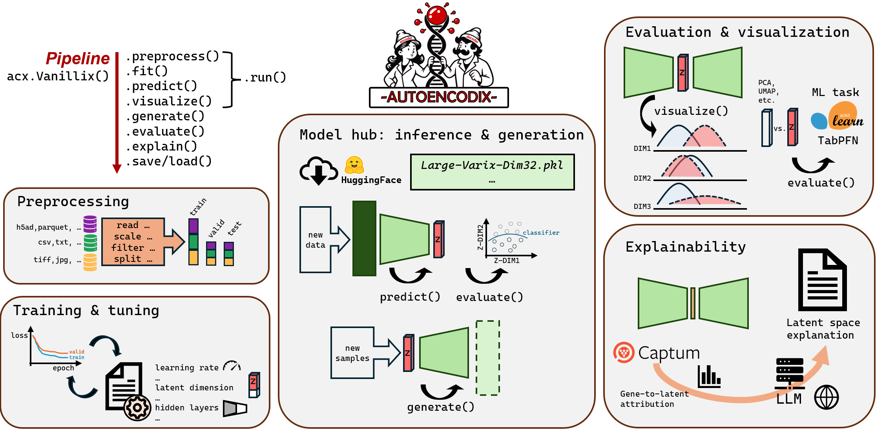
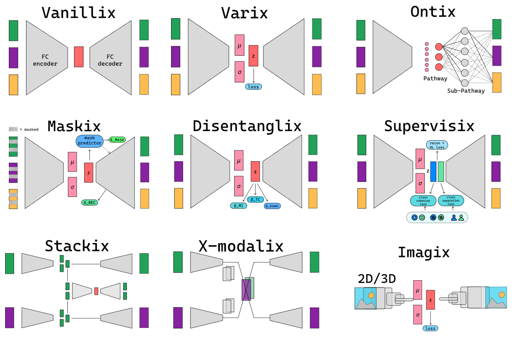

<p align="center">
  
</p>

<h3 align="center">One framework to train, evaluate, explain and share autoencoders for biological data and beyond</h3>

<p align="center">
  <a href="https://pypi.org/project/autoencodix/"></a>
  <a href="https://pypi.org/project/autoencodix/"></a>
  <a href="https://github.com/jan-forest/autoencodix_package/blob/main/LICENSE"></a>
  <a href="https://jan-forest.github.io/autoencodix_package/"></a>
  <a href="https://huggingface.co/autoencodix"></a>
  <a href="https://doi.org/10.1038/s43588-025-00916-4"></a>
</p>

<p align="center">
  <a href="https://jan-forest.github.io/autoencodix_package/">Documentation</a> ·
  <a href="https://github.com/jan-forest/autoencodix_package/tree/main/Tutorials">Tutorials</a> ·
  <a href="https://huggingface.co/collections/autoencodix/acx-pretrained-models">Pretrained models</a> ·
  <a href="https://github.com/jan-forest/autoencodix_package">GitHub</a> ·
  <a href="https://doi.org/10.1038/s43588-025-00916-4">Paper</a>
</p>

---

**AUTOENCODIX** is a Python framework for representation learning with autoencoders. It was designed with biological data in mind but is general enough for any tabular, multi-modal or image data. A growing collection of architectures, from vanilla and variational autoencoders to ontology-constrained, disentangled, masked, multi-modal and imaging models, all share one pipeline API. Each pipeline covers the full workflow: preprocessing, training, tuning, embedding, generation, evaluation, visualization and explanation.

Autoencoders compress high-dimensional, non-linear and multi-modal measurements into a compact latent space. Examples include bulk and single-cell omics, medical and microscopy images, and other complex data. That latent space can be used for data integration, clustering, classification, imputation, cross-modal translation and synthetic data generation. Many autoencoder variants have been published, but each usually comes with its own code, data format and evaluation. AUTOENCODIX puts them in one place, so you can compare architectures fairly, reuse pretrained models and focus on your research question.

```python
import autoencodix as acx

pipeline = acx.Varix(data=my_datapackage)   # pick any architecture
result = pipeline.run()                     # preprocess → fit → predict → visualize
```

## Table of contents

- [Highlights](#highlights)
- [Core features](#core-features)
- [Architectures](#architectures)
- [Installation and quick start](#installation-and-quick-start)
- [Pretrained models on Hugging Face](#pretrained-models-on-hugging-face)
- [Tutorials](#tutorials)
- [Contributing: architectures and pretrained models](#contributing-architectures-and-pretrained-models)
- [FAQ](#faq)
- [Citation](#citation)
- [License](#license)

## Highlights

- **Many architectures, one API.** Switching between architectures, for example from `Vanillix` to `Varix`, `Ontix` or `XModalix`, means changing a single class name. New architectures plug into the same pipeline.
- **Biology first, not biology only.** Native support for bulk and single-cell omics (`csv`, `parquet`, `h5ad`, `MuData`) and 2D/3D images (`tiff`, `jpg`, ...), in paired or unpaired multi-modal setups. Any other data that fits into a table or an image works the same way.
- **Pretrained models.** Ready-to-use single-cell encoders on the [Hugging Face Hub](https://huggingface.co/autoencodix) for embedding your own data without training.
- **Explainable by design.** Ontology-constrained latent spaces, feature-to-latent attributions with [Captum](https://captum.ai/), and LLM-assisted interpretation of latent dimensions.
- **Benchmark-informed defaults.** `propose_initial_config()` gives tuned starting configs derived from more than 100,000 benchmark training runs.
- **Reproducible.** Every setting lives in one validated (Pydantic) config. Runs can be fully seeded, and pipelines can be saved and reloaded.

## Core features

<p align="center">
  
</p>

Every architecture is a **pipeline object** with the same set of steps. Call `.run()` to execute the standard sequence, or call the steps one by one for full control:

| Step | What it does |
|---|---|
| `.preprocess()` | Reads, scales, filters and splits your data into train/valid/test |
| `.fit()` | Trains the autoencoder and tracks losses per epoch and split |
| `.predict()` | Encodes data into the latent space and reconstructs it |
| `.visualize()` | Plots loss curves, latent embeddings and latent distributions |
| `.generate()` | Samples new synthetic data from the latent space |
| `.evaluate()` | Benchmarks the embedding on downstream ML tasks |
| `.explain()` | Attributes latent dimensions to input features, optionally with LLM interpretation |
| `.save()` / `.load()` | Saves and restores the whole pipeline, including model, config and results |

**Preprocessing.** Load tabular data (`csv`, `txt`, `parquet`), single-cell data (`h5ad`, `AnnData`/`MuData`) and images (`tiff`, `jpg`, `png`, 3D volumes) through one `DataPackage`. Built-in scaling, feature filtering (variance, correlation, NaN handling), single-cell filters and reproducible data splits work on any number of modalities.

**Training and tuning.** Training uses PyTorch and Lightning Fabric on CPU, GPU or multiple devices. You can set mixed precision, β-annealing schedules, and the layer and latent-space design. Hyperparameter optimization works with the built-in search or with [Optuna](https://optuna.org/), and `propose_initial_config()` gives you a strong starting point.

**Model hub: inference and generation.** Load pretrained models from the [Hugging Face Hub](https://huggingface.co/autoencodix), embed new samples with `.predict()`, classify or cluster them in the latent space, and create synthetic samples with `.generate()`.

**Evaluation and visualization.** Compare your latent space against PCA, UMAP, t-SNE or random features on downstream classification and regression tasks with any scikit-learn estimator (or TabPFN). Visualize embeddings, per-dimension latent distributions, and disentanglement metrics such as total correlation and coverage.

**Explainability.** Compute feature-to-latent attributions, such as gene-level importance, with DeepLIFT-SHAP or Integrated Gradients via [Captum](https://captum.ai/). The top features of each latent dimension can then be passed to an LLM (Mistral, Ollama, OpenRouter, ...) for a domain-level interpretation of the latent space.

## Architectures

<p align="center">
  
</p>

| Pipeline | Type | Typical use case | Data | Key reference |
|---|---|---|---|---|
| [`Vanillix`](#vanillix) | Autoencoder | Non-linear dimension reduction, baseline | Tabular, multi-omics | [Hinton & Salakhutdinov 2006](https://doi.org/10.1126/science.1127647) |
| [`Varix`](#varix) | Variational AE | Smooth, generative latent space | Tabular, single-cell | [Kingma & Welling 2014](https://arxiv.org/abs/1312.6114) |
| [`Ontix`](#ontix) | Ontology-constrained VAE | Interpretable latent dimensions | Tabular, single-cell | [Seninge et al. 2021](https://doi.org/10.1038/s41467-021-26017-0); [Doncevic & Herrmann 2023](https://doi.org/10.1093/bioinformatics/btad387) |
| [`Disentanglix`](#disentanglix) | Disentangled VAE | Independent factors of variation | Tabular, single-cell | [Chen et al. 2018](https://arxiv.org/abs/1802.04942) |
| [`Maskix`](#maskix) | Masked AE | Robust embeddings, imputation | Tabular, single-cell | [Fang et al. 2024](https://doi.org/10.1093/bioinformatics/btae020) |
| [`Supervisix`](#supervisix) | Semi-supervised VAE | Label-guided embeddings | Tabular, single-cell | [Das et al. 2022](https://arxiv.org/abs/2203.14865) |
| [`Stackix`](#stackix) | Hierarchical VAE | Multi-modal integration, unpaired data | Multi-modal tabular | [Simidjievski et al. 2019](https://doi.org/10.3389/fgene.2019.01205) |
| [`XModalix`](#xmodalix) | Cross-modal VAE | Translation between modalities | Tabular ↔ images | [Yang & Uhler 2019](https://arxiv.org/abs/1902.03515) |
| [`Imagix`](#imagix-and-imagix3d) | Convolutional VAE | Image embeddings | 2D images | [Yang & Uhler 2019](https://arxiv.org/abs/1902.03515) |
| [`Imagix3D`](#imagix-and-imagix3d) | 3D convolutional VAE | Volumetric embeddings | 3D images (CT, MRI, microscopy) | [Yang & Uhler 2019](https://arxiv.org/abs/1902.03515) |

### Vanillix

A classic fully connected autoencoder that compresses the input into a deterministic bottleneck and reconstructs it. **Use it** as a fast, robust baseline for non-linear dimension reduction and multi-modal integration, or when you just need a compact feature representation. **Strengths:** simple, few hyperparameters, quick to train. It is also the reference implementation of the shared pipeline, so start here.

<sub>**Based on:** Hinton & Salakhutdinov (2006). Reducing the dimensionality of data with neural networks. *Science* 313, 504–507. [doi:10.1126/science.1127647](https://doi.org/10.1126/science.1127647)</sub>

### Varix

A variational autoencoder (VAE) that learns a probabilistic latent space (μ, σ) regularized toward a prior with a KL or MMD loss. **Use it** when you want a smooth, continuous latent space for clustering, trajectory analysis or generating synthetic samples. **Strengths:** a well-structured latent space, sampling-based generation, and β-annealing for a stable trade-off between reconstruction and regularization. Varix is the basis for most other architectures in the framework.

<sub>**Based on:** Kingma & Welling (2014). Auto-encoding variational Bayes. *ICLR*. [arXiv:1312.6114](https://arxiv.org/abs/1312.6114)</sub>

### Ontix

A VAE with a **sparse decoder whose connections follow an ontology or any other hierarchical feature grouping**. Examples are pathways → sub-pathways → genes, or chromosomes → cytobands → genes. Each latent dimension therefore corresponds to a named entity. **Use it** when interpretability matters, for example to read out pathway activity per sample or cell. **Strengths:** explainable by design, supports multi-level ontologies supplied as text files or Python dictionaries, and pairs naturally with `.explain()`.

<sub>**Based on:** Seninge et al. (2021). VEGA is an interpretable generative model for inferring biological network activity in single-cell transcriptomics. *Nat. Commun.* 12, 5684. [doi:10.1038/s41467-021-26017-0](https://doi.org/10.1038/s41467-021-26017-0) · Doncevic & Herrmann (2023). Biologically informed variational autoencoders allow predictive modeling of genetic and drug-induced perturbations. *Bioinformatics* 39(6), btad387. [doi:10.1093/bioinformatics/btad387](https://doi.org/10.1093/bioinformatics/btad387) · Joas et al. (2025), see [Citation](#citation)</sub>

### Disentanglix

A disentangled VAE that splits the KL term into **mutual information, total correlation and dimension-wise KL**, each with its own weight (`beta_mi`, `beta_tc`, `beta_dimKL`). **Use it** when you want latent dimensions that capture independent factors of variation, for example separating cell type from disease state. **Strengths:** more independent and interpretable dimensions, fine-grained control over regularization, and built-in disentanglement metrics.

<sub>**Based on:** Chen et al. (2018). Isolating sources of disentanglement in variational autoencoders (β-TCVAE). *NeurIPS*. [arXiv:1802.04942](https://arxiv.org/abs/1802.04942)</sub>

### Maskix

A masked autoencoder that randomly corrupts input entries and learns both to **reconstruct the original data and to predict which entries were masked**. **Use it** for sparse, noisy data such as single-cell transcriptomics, for robust embeddings, and for imputing missing values. **Strengths:** self-supervised denoising, good representations for clustering, and a built-in imputation method.

<sub>**Based on:** Fang et al. (2024). scMAE: a masked autoencoder for single-cell RNA-seq clustering. *Bioinformatics* 40(1), btae020. [doi:10.1093/bioinformatics/btae020](https://doi.org/10.1093/bioinformatics/btae020)</sub>

### Supervisix

A semi-supervised VAE that adds **class-cohesion and class-separation losses** on top of the VAE objective, pulling samples toward their class center and pushing class centers apart. **Use it** when (partial) labels such as cell types, disease groups or any other class annotation are available and the latent space should reflect them. **Strengths:** label-aware embeddings that still model unlabeled samples, and better separation for downstream classification.

<sub>**Based on:** the cluster (center) loss of the semi-supervised VAE in Das, Lønfeldt, Pagsberg & Clemmensen (2022). Towards transferable speech emotion representation: on loss functions for cross-lingual latent representations. *ICASSP 2022*. [arXiv:2203.14865](https://arxiv.org/abs/2203.14865)</sub>

### Stackix

A hierarchical (stacked) VAE: one **outer VAE per modality** learns a modality-specific latent space, and these latent spaces are concatenated and integrated by a **shared inner VAE**. **Use it** for integrating heterogeneous modalities such as multi-omics, especially when not every sample has every modality (`requires_paired=False`). **Strengths:** handles unpaired data, gives both per-modality and joint embeddings, and scales to many modalities.

<sub>**Based on:** Simidjievski et al. (2019). Variational autoencoders for cancer data integration: design principles and computational practice. *Front. Genet.* 10, 1205. [doi:10.3389/fgene.2019.01205](https://doi.org/10.3389/fgene.2019.01205) · Joas et al. (2025), see [Citation](#citation)</sub>

### XModalix

A cross-modal VAE that trains one encoder–decoder per modality and **aligns their latent spaces**, so that you can encode one modality and decode another. **Use it** to translate between data types, for example gene expression ↔ images, or to impute a missing modality. **Strengths:** works with paired and unpaired data, combines tabular and image modalities, and supports generation across modalities.

<sub>**Based on:** Yang & Uhler (2019). Multi-domain translation by learning uncoupled autoencoders. [arXiv:1902.03515](https://arxiv.org/abs/1902.03515)</sub>

### Imagix and Imagix3D

Convolutional VAEs for **2D images** (`Imagix`) and **3D volumes** (`Imagix3D`, for example CT, MRI or volumetric microscopy). **Use them** to embed imaging data, compare image phenotypes with omics or other tabular profiles, or serve as the image branch of `XModalix`. **Strengths:** a standard and a fast architecture variant, flexible input sizes, and diagnostics for active latent dimensions.

<sub>**Based on:** Yang & Uhler (2019). Multi-domain translation by learning uncoupled autoencoders. [arXiv:1902.03515](https://arxiv.org/abs/1902.03515). Imagix3D extends this design to 3D convolutions.</sub>

## Installation and quick start

### Installation

AUTOENCODIX requires Python ≥ 3.9 and < 3.13.

```bash
pip install autoencodix
```

To get the latest development version, use [uv](https://docs.astral.sh/uv/) (recommended):

```bash
git clone https://github.com/jan-forest/autoencodix_package.git
cd autoencodix_package
uv venv --python 3.10
source .venv/bin/activate
uv sync
```

### Train an autoencoder on your own data

```python
import autoencodix as acx
from autoencodix.data.datapackage import DataPackage
from autoencodix.configs.vanillix_config import VanillixConfig
from autoencodix.configs.default_config import DataCase

# Tabular (non-single-cell) data goes into `multi_bulk`: one or more modalities as pandas DataFrames.
# With one annotation table per modality, use the same keys as in multi_bulk instead of "paired".
data = DataPackage(
    multi_bulk={"rna": raw_rna, "protein": raw_protein},
    annotation={"paired": annotation},
)

config = VanillixConfig(data_case=DataCase.MULTI_BULK, epochs=30, device="cpu")
pipeline = acx.Vanillix(data=data, config=config)
result = pipeline.run()

latent = result.get_latent_df(split="test", epoch=-1)   # sample × latent-dimension DataFrame
```

➡️ Full walkthrough: [Vanillix: Getting Started](https://github.com/jan-forest/autoencodix_package/blob/main/Tutorials/PipelineTutorials/Vanillix.ipynb). Other data types (single-cell, images, unpaired data) are covered in [Input data](https://github.com/jan-forest/autoencodix_package/blob/main/Tutorials/DeepDives/InputDataTutorials.ipynb), and all config options in [Configuration](https://github.com/jan-forest/autoencodix_package/blob/main/Tutorials/DeepDives/ConfigTutorial.ipynb).

### Start from a benchmark-informed configuration

```python
config = acx.propose_initial_config("varix")   # tuned hyperparameters instead of generic defaults
pipeline = acx.Varix(data=data, config=config)
```

➡️ Objectives, training budgets and overrides: [Propose initial config](https://github.com/jan-forest/autoencodix_package/blob/main/Tutorials/DeepDives/ProposeInitialConfigTutorial.ipynb).

### Embed new data with a pretrained model

```python
from huggingface_hub import snapshot_download
import autoencodix as acx

path = snapshot_download(repo_id="autoencodix/Varix-Dim32-Varix")
model = acx.Varix.load(file_path=f"{path}/large_varix_final_model_Dim32_Varix.pkl")
result = model.predict(data=my_dataset_container)
```

➡️ Data preparation, visualization and explanation: [Using Pretrained Models](https://github.com/jan-forest/autoencodix_package/blob/main/Tutorials/DeepDives/UsingPreTrainedModels.ipynb). Available models are listed in [Pretrained models on Hugging Face](#pretrained-models-on-hugging-face).

### Go further

```python
result = pipeline.evaluate(params=["CANCER_TYPE"], reference_methods=["PCA", "UMAP"])   # benchmark the embedding
attributions = pipeline.explain(method="IntegratedGradients")                            # feature-to-latent attributions
samples = pipeline.generate(n_samples=100)                                               # synthetic data
```

➡️ See the [Evaluate](https://github.com/jan-forest/autoencodix_package/blob/main/Tutorials/DeepDives/EvaluateTutorial.ipynb) and [Explain](https://github.com/jan-forest/autoencodix_package/blob/main/Tutorials/DeepDives/ExplainStep.ipynb) deep dives, and the [Tutorials](#tutorials) overview for all architectures.

## Pretrained models on Hugging Face

> **Skip training: use a pretrained single-cell encoder.**
> We publish ready-to-use AUTOENCODIX models in the [**acx-pretrained-models**](https://huggingface.co/collections/autoencodix/acx-pretrained-models) collection on the Hugging Face Hub. Download one with a single line and embed your own scRNA-seq data in minutes.

| Model family | Latent dims | What you get | Models |
|---|---|---|---|
| **Varix** | 16 / 32 / 48 | General-purpose transcriptome embedding | [Dim16](https://huggingface.co/autoencodix/Varix-Dim16-Varix) · [Dim32](https://huggingface.co/autoencodix/Varix-Dim32-Varix) · [Dim48](https://huggingface.co/autoencodix/Varix-Dim48-Varix) |
| **Disentanglix** | 16 / 32 / 48 | Disentangled, independent latent factors | [Dim16](https://huggingface.co/autoencodix/Disentanglix-Dim16-Disentanglix) · [Dim32](https://huggingface.co/autoencodix/Disentanglix-Dim32-Disentanglix) · [Dim48](https://huggingface.co/autoencodix/Disentanglix-Dim48-Disentanglix) |
| **Ontix** (GPT-5.6 ontology) | 16 / 32 / 48 | Interpretable dimensions = biological processes | [Dim16](https://huggingface.co/autoencodix/Ontix-Dim16-GPT5-6) · [Dim32](https://huggingface.co/autoencodix/Ontix-Dim32-GPT5-6) · [Dim48](https://huggingface.co/autoencodix/Ontix-Dim48-GPT5-6) |
| **Ontix** (Claude Opus 5 ontology) | 16 / 32 / 48 | Interpretable dimensions = biological processes | [Dim16](https://huggingface.co/autoencodix/Ontix-Dim16-ClaudeOpus5) · [Dim32](https://huggingface.co/autoencodix/Ontix-Dim32-ClaudeOpus5) · [Dim48](https://huggingface.co/autoencodix/Ontix-Dim48-ClaudeOpus5) |
| **Ontix** (Kimi K3 ontology) | 16 / 32 / 48 | Interpretable dimensions = biological processes | [Dim16](https://huggingface.co/autoencodix/Ontix-Dim16-KimiK3) · [Dim32](https://huggingface.co/autoencodix/Ontix-Dim32-KimiK3) · [Dim48](https://huggingface.co/autoencodix/Ontix-Dim48-KimiK3) |

All models are trained on a balanced collection of nearly **4 million cells** from the [CZ CELLxGENE](https://cellxgene.cziscience.com/) collection. A detailed description of the training data and models will follow in an upcoming preprint.
<!-- TODO: add preprint link once available on bioRxiv. -->

**What you can do with a pretrained model:**

- **Embed** your own cells (`AnnData`, Ensembl gene IDs, log1p-normalized counts). Missing genes are zero-padded automatically through a template.
- **Annotate and classify** cells in the latent space with any scikit-learn model.
- **Interpret** Ontix dimensions directly as biological processes, or run `.explain()` with LLM support.
- **Generate** synthetic cells with `.generate()`.
- **Fine-tune** a model on your own data *(planned, not yet natively supported)*.

Each model card has a copy-paste usage example. For a complete walkthrough, see the [Using Pretrained Models tutorial](https://github.com/jan-forest/autoencodix_package/blob/main/Tutorials/DeepDives/UsingPreTrainedModels.ipynb).

The Hub also hosts the **tutorial datasets** ([TCGA](https://huggingface.co/datasets/autoencodix/tcga), [CELLxGENE lung](https://huggingface.co/datasets/autoencodix/census-lung), [pancreas](https://huggingface.co/datasets/autoencodix/pancreas-fang), [MNIST/MedMNIST](https://huggingface.co/datasets/autoencodix/mnist)) and the [benchmark-derived initial configs](https://huggingface.co/datasets/autoencodix/initial-configs). Tutorials download them automatically on first run.

## Tutorials

All tutorials are Jupyter notebooks that run on real data, which is downloaded automatically. They are also rendered in the [documentation](https://jan-forest.github.io/autoencodix_package/).

### Entry points

| If you want to... | Start with |
|---|---|
| Learn the framework (**start here**) | [Vanillix: Getting Started](https://github.com/jan-forest/autoencodix_package/blob/main/Tutorials/PipelineTutorials/Vanillix.ipynb) |
| Use a variational / generative model | [Varix](https://github.com/jan-forest/autoencodix_package/blob/main/Tutorials/PipelineTutorials/Varix.ipynb) |
| Get interpretable, ontology-based latent dimensions | [Ontix](https://github.com/jan-forest/autoencodix_package/blob/main/Tutorials/PipelineTutorials/Ontix.ipynb) |
| Integrate multiple data modalities | [Stackix](https://github.com/jan-forest/autoencodix_package/blob/main/Tutorials/PipelineTutorials/Stackix.ipynb) |
| Translate between modalities (e.g. omics ↔ images) | [XModalix](https://github.com/jan-forest/autoencodix_package/blob/main/Tutorials/PipelineTutorials/XModalix.ipynb) |
| Use a pretrained model without training | [Using Pretrained Models](https://github.com/jan-forest/autoencodix_package/blob/main/Tutorials/DeepDives/UsingPreTrainedModels.ipynb) |

Every architecture has its own tutorial in [PipelineTutorials](https://github.com/jan-forest/autoencodix_package/tree/main/Tutorials/PipelineTutorials). We recommend completing the Vanillix tutorial first.

### Deep dives

| Topic | What you'll learn |
|---|---|
| [Input data](https://github.com/jan-forest/autoencodix_package/blob/main/Tutorials/DeepDives/InputDataTutorials.ipynb) | Supported formats and how to build a `DataPackage` for tabular, single-cell and image data |
| [Configuration](https://github.com/jan-forest/autoencodix_package/blob/main/Tutorials/DeepDives/ConfigTutorial.ipynb) | All config options, YAML configs and validation |
| [Pipeline output](https://github.com/jan-forest/autoencodix_package/blob/main/Tutorials/DeepDives/PipelineOutputTutorial.ipynb) | Navigating the `Result` object: latent spaces, reconstructions, losses |
| [Visualize](https://github.com/jan-forest/autoencodix_package/blob/main/Tutorials/DeepDives/VisualizeTutorial.ipynb) | Built-in and custom plots of embeddings and training dynamics |
| [Evaluate](https://github.com/jan-forest/autoencodix_package/blob/main/Tutorials/DeepDives/EvaluateTutorial.ipynb) | Benchmarking embeddings on ML tasks against PCA, UMAP and others |
| [Explain](https://github.com/jan-forest/autoencodix_package/blob/main/Tutorials/DeepDives/ExplainStep.ipynb) | Feature attributions with Captum and LLM-based interpretation |
| [Propose initial config](https://github.com/jan-forest/autoencodix_package/blob/main/Tutorials/DeepDives/ProposeInitialConfigTutorial.ipynb) | Benchmark-informed hyperparameters in one call |
| [Hyperparameter optimization](https://github.com/jan-forest/autoencodix_package/blob/main/Tutorials/DeepDives/HyperparameterOptimizationTutorial.ipynb) · [with Optuna](https://github.com/jan-forest/autoencodix_package/blob/main/Tutorials/DeepDives/HyperparameterOptimizationOptunaTutorial.ipynb) | Systematic tuning of architecture and training |
| [Memory-efficient saving](https://github.com/jan-forest/autoencodix_package/blob/main/Tutorials/DeepDives/MemoryEfficientSaving.ipynb) | Saving and loading large pipelines and results |

## Contributing: architectures and pretrained models

AUTOENCODIX is a community project. Its value grows with every architecture and every trained model that others can reuse. We particularly welcome:

**New architectures.** Have you published, or do you use, an autoencoder variant that is missing here? Every architecture builds on the same base classes (`BaseAutoencoder`, `BaseLoss`, `BaseTrainer`, `BasePipeline`). A new model only needs its architecture, loss and, if necessary, a custom trainer. Preprocessing, evaluation, visualization, explainability and saving come for free. The [Developer Guide](https://github.com/jan-forest/autoencodix_package/blob/main/Tutorials/DevGuide.ipynb) explains how to add one.

**Pretrained models.** Have you trained an AUTOENCODIX model on an interesting atlas, tissue, organism, modality or a dataset outside biology? Share it with the community through the [autoencodix Hugging Face organization](https://huggingface.co/autoencodix). Open an issue and we will help you prepare a model card and add the model to the [pretrained collection](https://huggingface.co/collections/autoencodix/acx-pretrained-models).

**Everything else.** Bug reports, feature requests, tutorials, documentation fixes and benchmark datasets are all welcome.

How to get started:

1. Open an [issue](https://github.com/jan-forest/autoencodix_package/issues/new/choose) describing your idea, so that we can give early feedback.
2. Fork the repository, implement your change and add tests.
3. Open a [pull request](https://github.com/jan-forest/autoencodix_package/compare).

See [DEVELOPER.md](https://github.com/jan-forest/autoencodix_package/blob/main/DEVELOPER.md) for detailed guidelines, or reach us at [jan.ewald@uni-leipzig.de](mailto:jan.ewald@uni-leipzig.de).

## FAQ

<details>
<summary><b>I get a <code>RuntimeError</code> about deterministic behavior and CuBLAS</b></summary>

When you request full reproducibility (`FIX_RANDOMNESS: "all"` / `reproducible=True`) on CUDA ≥ 10.2, PyTorch may raise:

```
RuntimeError: Deterministic behavior was enabled with either `torch.use_deterministic_algorithms(True)` or `at::Context::setDeterministicAlgorithms(true)`, but this operation is not deterministic because it uses CuBLAS and you have CUDA >= 10.2.
```

Set this environment variable before running the pipeline (before `torch` is imported):

```bash
export CUBLAS_WORKSPACE_CONFIG=:16:8
```
</details>

<details>
<summary><b>Python crashes with a segmentation fault as soon as training starts</b></summary>

If the Python process or Jupyter kernel dies without a Python error when you call `fit()` or `run()`, the installed PyTorch build may not work with your GPU driver. We have seen this with `torch 2.15.0` (CUDA 13.2 build) under WSL2. The crash happens when PyTorch initializes CUDA and also occurs with `device="cpu"`. You can confirm it with:

```bash
python -c "import torch; print(torch.__version__, torch.cuda.is_available())"
```

If this command crashes as well, install an older PyTorch version:

```bash
pip install "torch<2.15"
```
</details>

<details>
<summary><b>Which architecture should I choose?</b></summary>

Start with `Vanillix` or `Varix` as a baseline, then pick a specialized architecture from the [Architectures](#architectures) table that matches your goal, such as interpretability, multi-modal integration, cross-modal translation or imputation. The `.evaluate()` step lets you compare them on your own data.
</details>

<details>
<summary><b>Can I use AUTOENCODIX for non-biological data?</b></summary>

Yes. Anything you can load into a `pandas.DataFrame`, `AnnData` or `MuData`, or store as image files, can be passed via `DataPackage`. Biology-specific components such as ontologies or single-cell filters are optional. See the [Input data tutorial](https://github.com/jan-forest/autoencodix_package/blob/main/Tutorials/DeepDives/InputDataTutorials.ipynb).
</details>

## Citation

If you use AUTOENCODIX in your research, please cite our publication in *Nature Computational Science*. A paper describing the Python package is in preparation.

> Joas, M. J., Jurenaite, N., Praščević, D., Scherf, N. & Ewald, J. AUTOENCODIX: a generalized and versatile framework to train and evaluate autoencoders for biological representation learning and beyond. *Nat. Comput. Sci.* (2025). [doi:10.1038/s43588-025-00916-4](https://doi.org/10.1038/s43588-025-00916-4)

```bibtex
@article{joas2025autoencodix,
  title     = {AUTOENCODIX: a generalized and versatile framework to train and evaluate autoencoders for biological representation learning and beyond},
  author    = {Joas, Maximilian Josef and Jurenaite, Neringa and Pra{\v{s}}{\v{c}}evi{\'c}, Du{\v{s}}an and Scherf, Nico and Ewald, Jan},
  journal   = {Nature Computational Science},
  year      = {2025},
  doi       = {10.1038/s43588-025-00916-4},
  publisher = {Nature Publishing Group US New York}
}
```

If you use a specific architecture, please also cite the original work listed in [Architectures](#architectures).

## License

AUTOENCODIX is released under the [Apache License 2.0](https://github.com/jan-forest/autoencodix_package/blob/main/LICENSE).
Copyright © 2026 Maximilian Josef Joas & Jan Ewald, [ScaDS.AI](https://scads.ai/), Leipzig University.
